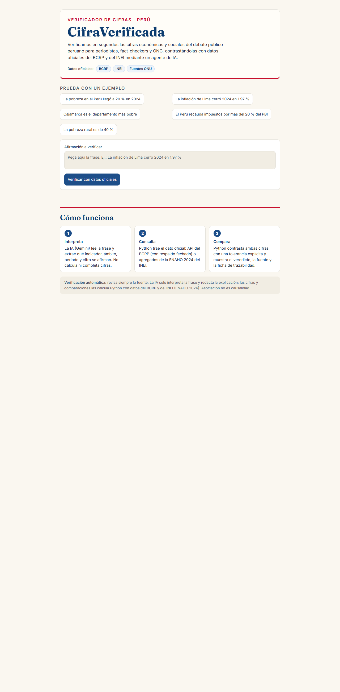
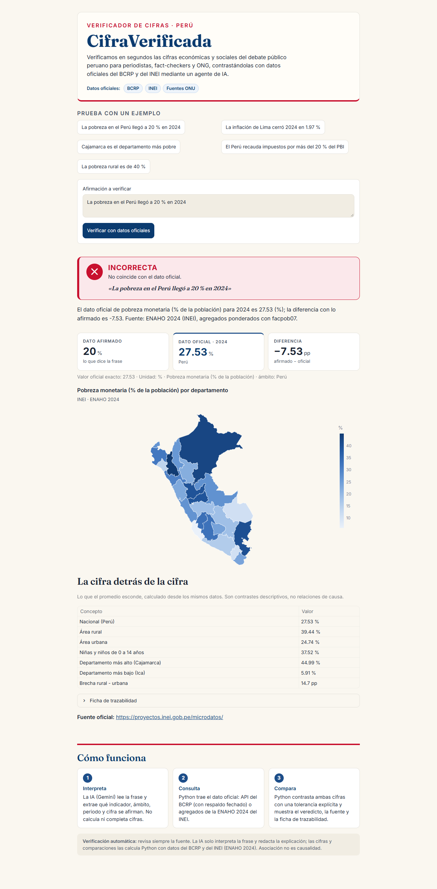
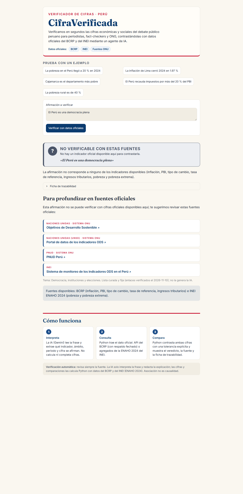
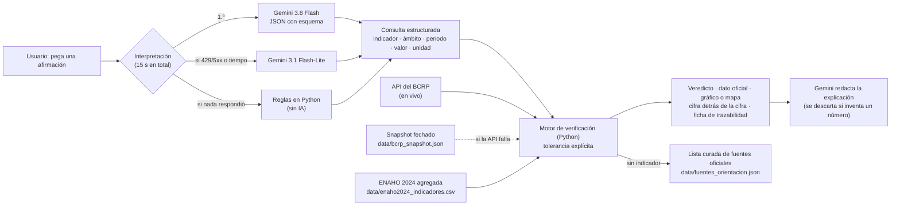

# CifraVerificada

> **Verificamos en segundos las cifras económicas y sociales del debate público peruano para periodistas,
> fact-checkers y ONG, contrastándolas con datos oficiales del BCRP y del INEI mediante un agente de IA.**

**Demo:** https://cifraverificada.streamlit.app · Proyecto final de la Diplomatura de Ciencia de Datos para las
Ciencias Sociales y la Gestión Pública (Q-Lab PUCP), [Issue #204](https://github.com/d2cml-ai/Data-Science-Python/issues/204).
Proyecto de impacto social, gratuito para la ciudadanía.

**Contenido:** [1. One-liner](#1-one-liner) · [2. Founder](#2-founder) · [3. Problema](#3-problema) ·
[4. Solución e insight](#4-solución-e-insight) · [5. Why now](#5-why-now) · [6. Demo](#6-demo) ·
[7. Modelo de sostenibilidad](#7-modelo-de-sostenibilidad) · [8. Herramientas del curso](#8-herramientas-del-curso) ·
[9. Qué hizo el agente](#9-qué-hizo-el-agente) · [Competencia, riesgos y plan](#competencia-riesgos-y-plan-a-3-meses) ·
[Cómo correrla](#cómo-correrla-en-local)

---

## 1. One-liner

**Hacemos** la verificación de cifras económicas y sociales **para** periodistas, fact-checkers, ONG y
estudiantes que publican sobre el Perú, **mediante** una IA que solo interpreta la frase, y un motor en Python
que la contrasta con la serie oficial del BCRP o con la ENAHO del INEI y muestra el veredicto, la fuente y lo
que el promedio esconde.

## 2. Founder

**Ricardo Antonio Macedo Villegas.** Estudiante de Economía y sociólogo por la PUCP, interesado en política
fiscal y desigualdad.

**Por qué soy la persona indicada.** Ya trabajé con las mismas fuentes que usa el producto:

- **BCRP:** construí un servidor MCP que consulta la API de series estadísticas del BCRP (Tarea 4). Sus
  funciones son la base de [`app/fuentes.py`](app/fuentes.py).
- **ENAHO:** con mis *Skills* de Claude Code (limpiar, graficar y mapear la ENAHO) calculé la pobreza 2024
  ponderada con `facpob07`. De ahí salen los agregados de [`data/`](data/).
- **Justicia tributaria:** proyectos sobre recaudación y desigualdad, de donde viene el "modo fiscal"
  (ingresos tributarios como % del PBI).
- Portafolio: **https://antoniomacedo17.github.io**

Como sociólogo y economista sé qué cifras se discuten, cuáles se distorsionan y por qué un promedio puede
ocultar una brecha. Eso define el producto más que el código.

**Cómo cubro los cuatro roles con agentes de IA:**

| Rol | Qué hago yo | Qué hace el agente |
|---|---|---|
| Producto | Elijo el problema, entrevisto a usuarios, defino reglas y veredictos | Ordena la evidencia y redacta borradores |
| Ingeniería | Reviso el código, decido arquitectura, respaldos y límites | Escribe el código y las pruebas (Claude Code) |
| Diseño | Defino la paleta y el tono institucional | Implementa el tema y toma capturas para comparar |
| Difusión | Presentación, redes, alianzas con universidades | Borradores de textos que reviso |

## 3. Problema

**Quién lo sufre.** Quien **publica** cifras sobre el Perú con poco tiempo para revisarlas: redacciones
digitales, fact-checkers, ONG, comunicadores y estudiantes que producen contenido (podcasts, ensayos, posts).
Y quien los lee, porque las cifras erradas circulan. Las [3 conversaciones](docs/research/sintesis.md) (10 de noviembre de 2026, por WhatsApp)
coinciden en dónde aparecen: los tres entrevistados vieron cifras equivocadas o sin fuente en **redes
sociales, medios digitales y blogs**.

**Cuánto cuesta.** Depende de qué tan específica es la cifra:

| Caso | Tiempo reportado | Fuente |
|---|---|---|
| Cifra de titular (pobreza nacional) | "un par de minutos" | [Conversación 3](docs/research/conversacion_3.md) |
| Verificación rigurosa de una cifra conocida | 30 s (básico) a 5 min (riguroso) | [Conversación 2](docs/research/conversacion_2.md) |
| Dato de un tema puntual (El Niño, seguridad) | 30-40 min o más | [Conversación 1](docs/research/conversacion_1.md) |

A esto se suma el costo de **equivocarse**: datos desactualizados, enlaces que "cuando le doy clic no existe"
(C1) y no llegar a la fuente original, "que no es un blog o algo así" (C2).

**Cómo se resuelve hoy.** Con Google y, cada vez más, con la **respuesta de IA del buscador**: C2 empieza por
"lo que me dice Gemini" y solo abre la fuente si no le convence. Para más rigor se va a mano al BCRP o al INEI.

**Lo que no confirmó la investigación.** Para la cifra más conocida (pobreza nacional), verificar **es fácil**
(C3). El valor de CifraVerificada no está en repetir el titular, sino en el dato específico, la trazabilidad y
el contexto. Detalle en la [síntesis](docs/research/sintesis.md). Límite: entrevisté a tres estudiantes, no a
periodistas en ejercicio.

## 4. Solución e insight

Pegas una afirmación ("La pobreza en el Perú llegó a 20 % en 2024") y en segundos obtienes:

1. **Veredicto:** CORRECTA / APROXIMADA / INCORRECTA / NO VERIFICABLE CON ESTAS FUENTES, con una
   **tolerancia explícita** (ver [`app/verificador.py`](app/verificador.py)).
2. **Dato oficial, diferencia y gráfico o mapa** por departamento.
3. **"La cifra detrás de la cifra"** (el insight): lo que el promedio esconde, calculado de los mismos datos.
   Pobreza nacional 27.53 %, pero rural 39.44 %, niñez de 0 a 14 años 37.52 % y Cajamarca 44.99 % frente a
   Ica 5.91 % (ENAHO 2024, `facpob07`). Son contrastes descriptivos: **asociación no es causalidad**.
4. **Ficha de trazabilidad visible:** código de serie del BCRP (o fuente ENAHO y factor `facpob07`), periodo,
   URL, tolerancia, fecha y hora de consulta (hora de Lima), si el dato vino de la API en vivo o del snapshot
   fechado, qué modelo interpretó la frase y cuántos tokens usó.
5. **Orientación cuando no hay cifra:** "En el Perú no hay democracia" da NO VERIFICABLE y sugiere 2-4
   **fuentes oficiales de una lista curada** ([`data/fuentes_orientacion.json`](data/fuentes_orientacion.json)),
   priorizando el sistema de la ONU (CEPAL, PNUD, ONU/ODS, OMS, UNESCO…). Python pone los enlaces, verificados
   uno por uno; la IA solo elige el tema.

**La regla que lo hace confiable:** el modelo **nunca** escribe una cifra. Interpreta la frase y redacta la
explicación. Si esa explicación menciona un número que no está en los datos calculados por Python, se
reemplaza por una plantilla. Esto lo diferencia de la respuesta de IA de un buscador.

Frases sin cifra explícita: "ya no hay pobres" se lee como 0 % y "la mayoría de peruanos es pobre" como más
del 50 %, y se contrastan con la ENAHO.

## 5. Why now

- **LLM baratos con salida estructurada:** hoy un modelo devuelve un JSON validado con esquema (indicador,
  ámbito, periodo, valor, unidad) por menos de **S/ 0.002 por verificación** (ver §7). Hace tres años esto era
  caro, lento y poco fiable para el español peruano, y había que escribir reglas para cada forma de decir una
  cifra.
- **Datos oficiales abiertos y consultables por código:** la API de series del BCRP responde en JSON sin clave
  y los microdatos de la ENAHO del INEI son descargables. Con agentes de programación, una persona procesa la
  ENAHO y conecta la API en días.
- **Más desinformación numérica:** las cifras circulan en redes y medios digitales sin tiempo de verificación
  (lo dicen los tres entrevistados), y la respuesta de IA de los buscadores no garantiza que la cifra salga de
  la serie oficial.

## 6. Demo

**URL pública:** **https://cifraverificada.streamlit.app** (Streamlit Community Cloud).
**Video de respaldo (76 s):** https://youtu.be/HsRFOuhdgI4

### Capturas del flujo

| 1. Inicio: ejemplos y frase | 2. Veredicto, mapa y cifra detrás de la cifra | 3. Sin indicador: orientación a fuentes oficiales |
|---|---|---|
|  |  |  |

Otras capturas (versión de celular, cifra implícita y el diseño anterior) en [`docs/capturas/`](docs/capturas/).

### Arquitectura



### Modelos y APIs, y por qué

| Componente | Qué es | Por qué |
|---|---|---|
| **Gemini 3.8 Flash** (`gemini-3.8-flash`) | Interpreta la frase en JSON con esquema (Pydantic) y redacta la explicación | Salida estructurada fiable y barata; lo usé en la Tarea 2 |
| **Gemini 3.1 Flash-Lite** (`gemini-3.1-flash-lite`) | Respaldo automático ante 429/500/503/504 o tiempo agotado | Más barato y disponible cuando el principal está saturado |
| **Reglas en Python** ([`ai/reglas.py`](ai/reglas.py)) | Respaldo sin IA si en **15 s** nadie respondió | Que la demo nunca se quede esperando; la ficha dice "reglas en Python (sin IA)" y el motivo |
| **API del BCRP** + snapshot fechado | 6 series: inflación de Lima, PBI anual y mensual, tipo de cambio, tasa de referencia, ingresos tributarios (% del PBI) | Fuente oficial abierta; si no responde se usa el snapshot y se muestra su fecha |
| **ENAHO 2024** (agregados validados) | Pobreza y pobreza extrema por área, sexo, edad y 25 departamentos, ponderadas con `facpob07` | El repo no contiene microdatos. La pobreza nacional calculada es 27.53 % frente al 27.6 % oficial del INEI (diferencia de método) |
| **Lista curada de fuentes** | 2-4 enlaces oficiales por tema (ONU, CEPAL, PNUD, INEI, BCRP, MEF) | Los enlaces no los genera la IA; se re-verifican con `uv run python -m app.orientacion` |

## 7. Modelo de sostenibilidad

Es un **proyecto de impacto social**: gratis para quien verifica y financiado por instituciones. Las
conversaciones lo respaldan: nadie propuso que pague el usuario final, los tres señalaron a **universidades**
con apoyo del **Estado**, y una persona pidió **varias fuentes** de financiamiento para cuidar la
independencia ([síntesis](docs/research/sintesis.md)).

### Planes (precios en soles)

| Plan | Para quién | Precio | Incluye |
|---|---|---|---|
| **Ciudadanía** | Ciudadanía, periodistas, estudiantes | **S/ 0** | 20 verificaciones al día por usuario |
| **Equipo** | Redacciones, fact-checkers y ONG | **S/ 150 al mes** | 3,000 verificaciones al mes, soporte y fichas exportables (en desarrollo) |
| **Institucional** | Universidades, centros de investigación, entidades públicas | **S/ 900 al mes** | 15,000 verificaciones al mes, uso en aulas, indicadores nuevos a pedido |

### Costo por verificación (tokens medidos + precio oficial)

**Tokens medidos:** el 10 de noviembre de 2026 verifiqué 10 frases en vivo con la app (registro local
`data/registro_tokens.csv`, que no se versiona). En 8 respondió Gemini y en 2 entraron las reglas sin IA,
porque nadie respondió en 15 s. Las 8 respuestas vinieron del respaldo `gemini-3.1-flash-lite`: el modelo
principal no respondió a tiempo esa noche. Promedio por verificación con IA:

| Etapa | Tokens de entrada | Tokens de salida |
|---|---:|---:|
| Interpretar la frase | 881 | 78 |
| Redactar la explicación | 277 | 66 |
| **Total** | **1,158** | **144** |

**Precio oficial** (nivel pago estándar, USD por millón de tokens; la salida incluye los tokens de
razonamiento), según la [página oficial de precios de la API de Gemini](https://ai.google.dev/gemini-api/docs/pricing)
consultada el **10 de noviembre de 2026** (la página no muestra fecha de actualización):

| Modelo | Entrada | Salida |
|---|---:|---:|
| `gemini-3.1-flash-lite` | USD 0.25 | USD 1.50 |
| `gemini-3.8-flash` | USD 0.75 hasta el 31/12/2026; **USD 1.50** desde el 1/1/2027 | USD 3.75 hasta el 31/12/2026; **USD 7.50** desde el 1/1/2027 |

**Costo por verificación**, con el tipo de cambio de S/ 3.367 por US$ (BCRP, serie PN01210PM, diciembre de
2025, del snapshot del repositorio):

| Escenario | USD | Soles | Por 1,000 verificaciones |
|---|---:|---:|---:|
| **Medido** (flash-lite, tokens de arriba) | 0.00051 | **S/ 0.0017** | S/ 1.70 |
| **Techo** (supuesto: todo con 3.8 Flash a precio 2027, redondeado a 1,200 de entrada y 1,000 de salida por los tokens de razonamiento) | 0.0093 | **S/ 0.031** | S/ 31.31 |

El techo es un supuesto conservador, no una medición. La única llamada registrada con 3.8 Flash (9/11, con un
prompt más corto) usó 551 de entrada y 362 de salida con razonamiento, solo para interpretar.

**Servidor:** Streamlit Community Cloud, **S/ 0**. La API del BCRP y los agregados de la ENAHO son gratuitos.

### Margen de contribución mensual

| Plan | Ingreso | Costo medido | Margen medido | Costo techo | Margen techo |
|---|---:|---:|---:|---:|---:|
| Equipo (3,000 verificaciones) | S/ 150 | S/ 5.11 | **S/ 144.89 (97 %)** | S/ 93.93 | **S/ 56.07 (37 %)** |
| Institucional (15,000 verificaciones) | S/ 900 | S/ 25.56 | **S/ 874.44 (97 %)** | S/ 469.66 | **S/ 430.34 (48 %)** |

Al costo medido, el margen de un solo plan Equipo paga unas **85,000 verificaciones gratuitas** al mes. Como
la API de Gemini es de pago, en producción se fija un **tope de gasto** mensual en la cuenta de facturación, y
el límite diario del plan gratuito evita abusos.

## 8. Herramientas del curso

Dentro del producto:

| Herramienta (sesión) | Archivo | Por qué esta |
|---|---|---|
| **LLM con salida estructurada** (08) | [`ai/interpretar.py`](ai/interpretar.py) (y respaldo en [`ai/reglas.py`](ai/reglas.py)) | Convertir lenguaje natural en una consulta con esquema es justo lo que un LLM hace bien. El esquema impide que el modelo devuelva cifras propias |
| **APIs del BCRP**, reutilizando las funciones de mi servidor **MCP** de la Tarea 4 (03-04) | [`app/fuentes.py`](app/fuentes.py) | La fuente oficial de las series macro. Reutilicé código probado (fechas, periodos, reintentos) en lugar de escribirlo otra vez |
| **Mapa coroplético** (06) y **dashboard en Streamlit** (05) | [`app/streamlit_app.py`](app/streamlit_app.py) | El mapa por departamento hace visible "la cifra detrás de la cifra". Streamlit permite desplegar gratis en una URL pública |
| **Agregados de la ENAHO** producidos con mis **Skills** de la Tarea 4 (16) | [`data/enaho2024_indicadores.csv`](data/enaho2024_indicadores.csv) | Los Skills (limpiar, graficar y mapear la ENAHO) ya validaban la pobreza con `facpob07`. El producto solo usa agregados, sin microdatos |

Fuera del producto: **Whisper** (sesión 13) sirvió para la **investigación de usuarios**. Transcribí las
entrevistas en local con `faster-whisper` (large-v3-turbo), sin enviar los audios a ningún servicio. Las
transcripciones completas no están en el repositorio, solo las [notas anónimas](docs/research/).

## 9. Qué hizo el agente

El código lo escribió **Claude Code** en tres sesiones, con instrucciones mías en cada bloque. Las sesiones
exportadas están en [`docs/agente/`](docs/agente/):
[sesión 1](docs/agente/sesion_1.md) (estructura, datos, motor, Gemini, app y respaldo sin IA),
[sesión 2](docs/agente/sesion_2.md) (despliegue y diagnóstico en la nube),
[sesión 3](docs/agente/sesion_3.md) (cliente de Gemini en Python 3.14, frases sin cifra, orientación y
rediseño). Esta última sesión (README, research y revisión final) también la hizo Claude Code.

**Qué generó Claude Code:** la estructura del repo; la adaptación de las funciones del BCRP de mi Tarea 4; el
motor de verificación y sus tolerancias; el intérprete con esquema JSON y el registro de tokens; las reglas de
respaldo; la interfaz en Streamlit (gráficos, mapa, ficha, CSS); 60 pruebas en pytest; el snapshot; las
capturas antes y después; la transcripción local con Whisper; y los borradores de las notas de investigación,
la síntesis y este README.

**Qué decidí yo:**

- **El problema, el one-liner y los tres sellos:** "la cifra detrás de la cifra", el modo fiscal (ingresos
  tributarios) y la ficha de trazabilidad.
- **La regla central:** el LLM solo interpreta y redacta; ninguna cifra sale del modelo ([`CLAUDE.md`](CLAUDE.md)).
- **El respaldo sin IA** y sus condiciones: solo si Gemini falla, que la ficha diga "reglas en Python (sin IA)"
  y el motivo, y que nunca invente.
- **El límite de 15 s** para pasar a las reglas. Lo mantuve en 15 s a pesar de que el modelo principal a veces
  tarda más.
- **Los modelos:** Gemini 3.8 Flash (de mi Tarea 2), con respaldo Flash-Lite aprobado el 9/11.
- **Las tolerancias:** que fueran explícitas y visibles en cada veredicto. Los umbrales concretos (0.1 y
  0.5 pp, 10 % relativo) los propuso el agente y yo los aprobé.
- **La lista curada de fuentes** para frases sin indicador, con prioridad a la ONU, sin enlaces generados por
  la IA.
- **La paleta institucional** marfil, azul y rojo, tomada de mi sitio web y de mi Tarea 3.
- **La investigación:** las 5 preguntas, las 3 entrevistas, el consentimiento y la revisión de las notas.

## Competencia, riesgos y plan a 3 meses

**Competencia y alternativas**

| Alternativa | Fortaleza | Limitación frente a CifraVerificada |
|---|---|---|
| No hacer nada (publicar sin verificar) | Cero tiempo | Es de donde salen las cifras erradas que vieron los tres entrevistados |
| Buscar a mano en el INEI o el BCRP | Fuente primaria | De segundos a 40 minutos o más, enlaces caídos, sin desglose inmediato |
| Respuesta de IA del buscador (Gemini, etc.) | Inmediata y gratuita | La cifra la escribe un modelo; no hay código de serie ni tolerancia |
| Fact-checkers profesionales | Rigor y contexto | Revisan pocas frases, con días de trabajo |
| Portales oficiales (BCRPData, INEI) | Datos completos | Requieren saber qué serie buscar; no responden a una frase |

**Riesgos principales**

1. **Disponibilidad de Gemini:** el modelo principal se satura (503). Mitigación: respaldo Flash-Lite, reglas
   en Python en 15 s y motivo visible en la ficha.
2. **Cobertura limitada:** hoy hay 6 series del BCRP y la pobreza de la ENAHO. Fuera de eso, el veredicto es
   NO VERIFICABLE más orientación.
3. **Datos que envejecen:** la ENAHO es anual y la API del BCRP puede caerse. Mitigación: snapshot fechado y
   fecha siempre visible.
4. **Que se lea como causalidad o como verdad absoluta:** aviso de verificación automática y regla de
   "asociación ≠ causalidad".
5. **Costo si sube el uso o el precio (enero de 2027):** límite diario gratuito y tope de gasto.

**Plan a 3 meses**

- **Mes 1:** conversar con 5 redacciones o fact-checkers peruanos (el usuario que faltó en esta
  investigación) y medir cuántas cifras verifican por semana.
- **Mes 2:** más indicadores desagregados (empleo e ingresos de la ENAHO, ejecución del gasto del MEF) y
  exportar la ficha a PDF.
- **Mes 3:** piloto con una universidad (plan Institucional) en cursos de periodismo y economía; buscar fondos
  de cooperación para el plan gratuito.

---

## Cómo correrla en local

```bash
uv sync
cp .env.example .env           # y escribe tu GEMINI_API_KEY
uv run streamlit run app/streamlit_app.py
uv run pytest -q               # pruebas (sin red ni LLM)
uv run python -m app.fuentes   # (opcional) actualizar el snapshot del BCRP
```

Sin clave de Gemini la app funciona igual con las reglas en Python (sin IA), y la ficha lo indica.

### Indicadores verificables

| Indicador | Fuente | Código / método |
|---|---|---|
| Inflación Lima Metropolitana (var. % 12 meses) | BCRP | PN01273PM |
| Crecimiento del PBI (anual / mensual) | BCRP | PM04863AA / PN01728AM |
| Tipo de cambio bancario (S/ por US$) | BCRP | PN01210PM |
| Tasa de referencia | BCRP | PD04722MM |
| Ingresos tributarios del gobierno general (% del PBI) | BCRP | PM05876FA |
| Pobreza y pobreza extrema 2024 (nacional, área, sexo, edad, 25 departamentos) | INEI, ENAHO 2024 | personas ponderadas con `facpob07` |

**Tolerancias** (diferencia = afirmado − oficial): CORRECTA si |diferencia| ≤ 0.1 pp o media unidad del último
decimal afirmado ("20 %" acepta 19.5-20.5); APROXIMADA si ≤ 0.5 pp o 10 % del valor oficial; INCORRECTA en otro
caso. Para el tipo de cambio: 0.01, 0.05 y 2 %. Detalle en [`app/verificador.py`](app/verificador.py).

### Despliegue (Streamlit Community Cloud)

- Repo `AntonioMacedo17/cifraverificada`, rama `main`, archivo `app/streamlit_app.py`. La nube corre con
  Python 3.14; en local se desarrolla con 3.12, y las pruebas pasan en ambas versiones.
- La clave va en *Settings → Secrets* como `GEMINI_API_KEY = "..."`, nunca en el repositorio.
- Gemini: un intento de 10 s con `gemini-3.8-flash` y, si da 429/500/503/504 o se agota, `gemini-3.1-flash-lite`
  (la API rechaza plazos menores a 10 s). No se inicia un intento pasados 15 s; después entran las reglas en
  Python.
- Las fechas se muestran en hora de Lima (`America/Lima`): el servidor corre en UTC.
- `.streamlit/config.toml` desactiva la vigilancia de archivos (evita un `KeyError: 'app'` al recargar). Si
  tras un push la app no se actualiza, usar *Reboot app*.
- Dependencias: `uv.lock` y `requirements.txt` (exportado del mismo lock con `uv export`).

### Estructura

```
app/    streamlit_app.py (interfaz), verificador.py (tolerancias), fuentes.py (BCRP + ENAHO), orientacion.py
ai/     interpretar.py (Gemini, esquema JSON, tokens), reglas.py (respaldo sin IA)
data/   bcrp_snapshot.json, enaho2024_indicadores.csv, fuentes_orientacion.json, geojson departamental
tests/  pruebas del motor, reglas, frases sin cifra, cliente de Gemini y despliegue
docs/   research/ (3 conversaciones y síntesis), agente/ (sesiones con Claude Code), capturas/
```

Licencia [MIT](LICENSE): cubre el código. Los datos pertenecen al BCRP y al INEI.
